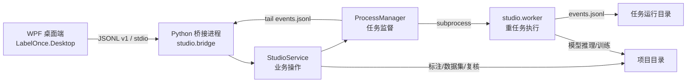

# 架构总览

Label Once 采用“桌面端 UI + Python 后端 + 独立 worker 子进程”的三层本地架构。所有组件都运行在同一台 Windows 机器上，不依赖远程服务。

---

## 1. 组件分层



| 层 | 位置 | 职责 |
| --- | --- | --- |
| WPF 桌面端 | `desktop/LabelOnce.Desktop` | 交互、画布、快捷键、页面导航、调用后端 |
| 几何与撤销核心 | `desktop/LabelOnce.Core` | 坐标变换、标注模型、历史记录（纯 .NET，可单测） |
| 桥接进程 | `studio/bridge.py` | 常驻进程，逐行读写 JSONL，分发 RPC |
| 业务服务 | `studio/service.py` | 项目状态、标注/复核/数据集/任务编排，不导入 Qt |
| 任务监督 | `studio/processes.py` | 启动 worker、跟踪事件、取消、控制命令 |
| 重任务 worker | `studio/worker.py` | 延迟导入 torch/ultralytics，执行训练、推理、导出等 |
| 旧 Qt GUI | `studio/app.py` | 保留的 PyQt5 界面，与 WPF 共享服务层 |
| 公共领域模型 | `studio/domain.py` | `Project`、`Labels`、`Box`、原子写入 |

**关键约束：**

1. `studio/service.py` 与 `studio/bridge.py` 不导入 Qt，因此可被 WPF 和 PyQt5 共用，也便于无头测试。
2. torch/ultralytics 只在 worker 的具体任务方法中延迟导入，启动桥接进程时不会加载重型 ML 运行时。
3. 同一时刻只允许一个后台任务；项目切换、类别修改、标注保存等操作在任务忙碌时会被拒绝或要求先停止。

---

## 2. 进程拓扑

### 2.1 生产/成品模式

```text
LabelOnce.exe (WPF, self-contained)
  └─ backend/backend.exe --bridge        # 隐藏窗口，stdin/stdout 重定向
       ├─ studio.bridge                  # JSONL RPC 服务
       └─ backend.exe --worker task.json # 每个任务一个子进程
```

`BridgeClient` 用 `CreateNoWindow` + 重定向管道启动后端，标准输入发送请求，标准输出只接收 JSON 帧，标准错误作为日志流。

### 2.2 源码开发模式

```text
LabelOnce.exe
  └─ python -m studio.bridge
       └─ python -m studio.worker task.json
```

`BridgeClient` 会向上遍历目录查找 `backend_launch.py` 以定位源码根目录；Python 解释器可通过 `LABELONCE_PYTHON` 指定，默认查找 `~/anaconda3/envs/labelonce/python.exe`。

### 2.3 旧 Qt 模式

```text
python launch.py
  └─ studio.app:main (PyQt5)
       └─ studio.qt_tasks.TaskManager
            └─ studio.processes.ProcessManager
                 └─ python -m studio.worker task.json
```

Qt 版与 WPF 版共享 `ProcessManager` 的磁盘协议，因此任务目录、事件流和取消语义一致。

---

## 3. 入口分发

`launch.py` 与 `backend_launch.py` 都先调用 `multiprocessing.freeze_support()`，再按参数分流：

| 参数 | 行为 | 用途 |
| --- | --- | --- |
| `--worker <task.json>` | 调用 `studio.worker.main(task_path)` | 任务子进程 |
| `-m <module>` | `runpy.run_module` | Ultralytics DDP 等以 `sys.executable` 拉起模块的场景 |
| `<script.py>` | `runpy.run_path` | 以当前解释器执行脚本 |
| 无参数（`launch.py`） | `studio.app:main` | PyQt5 GUI |
| 无参数（`backend_launch.py`） | `studio.bridge:main` | 无头 JSONL 后端 |

`ProcessManager` 在源码模式使用 `sys.executable -X utf8 -m studio.worker`，在冻结模式使用 `sys.executable --worker`。

---

## 4. 任务运行目录与文件协议

每个任务有独立目录（通常位于 `<项目>/runs/<kind>_<时间戳>_<随机串>/`）：

```text
runs/train_20261026_101500_ab12cd34/
├── task.json        # 任务输入（kind、project、model、params、dataset 等）
├── events.jsonl     # worker 追加的事件流（进度、epoch、结果、错误）
├── process.log      # 子进程 stdout/stderr 原始日志
├── cancel           # 存在即请求协作式取消
├── control.json     # 监督层写入的实时控制命令（跟踪暂停/纠偏等）
├── result.json      # 成功结束时的结果快照
└── weights/         # 训练任务的权重输出（由 Ultralytics 创建）
```

- `ProcessManager.start()` 会清理旧的 `cancel`/`control.json`，原子清空 `events.jsonl`，写入 `task.json`，再启动子进程。
- `_watch` 线程以二进制方式增量读取 `events.jsonl`，按行解析；坏行只记录并跳过，不会让监督线程崩溃。
- 进程退出后还会做一次最终读取，确保刷盘的最后一条 `result`/`error`/`cancelled` 不丢失。
- 若进程退出但从未收到终止事件，监督层补发一条 `error`（“后台进程异常退出”）。
- `finished` 事件总是在清理阶段发出，携带退出码与任务元数据。

`cancel` 与 `control.json` 的细节见 [视频工作流](./05-video-workflow.md) 和 [桥接协议](./09-bridge-protocol.md)。

---

## 5. 支持的任务类型

`StudioService.dispatch('task.start', ...)` 接受以下 `kind`（完整校验见 `service.py`）：

| kind | 作用 | 主要实现 |
| --- | --- | --- |
| `prelabel` | YOLO 批量预标注 | `Worker.prelabel` |
| `model_info` | 读取模型类别表 | `Worker.model_info` |
| `sam` | 单图 SAM 分割 | `Worker.sam` |
| `train` | 训练 / 续训 | `Worker.train` |
| `predict` | 图片、目录或视频推理 | `Worker.predict` |
| `evaluate` | 在 test split 上评估 | `Worker.evaluate` |
| `export` | ONNX/OpenVINO/TensorRT/TorchScript 导出 | `Worker.export` |
| `extract` | 视频按时间戳抽帧 | `studio.video_sampling` |
| `import_video` | 导入跟踪/抽帧结果 | `studio.review.import_video` |
| `inspect_images` | 检查损坏图片/最小尺寸 | `Worker.inspect_images` |
| `dataset` | 创建数据集版本 | `Worker.dataset` |
| `dataset_merge` | 多来源整合为新版本 | `studio.merge` |
| `tracking` | SAM2 视频跟踪 | `studio.tracking` |
| `segment_dataset` | 导出分割数据集 | `studio.segmentation` |
| `gate` | 发布门禁 | `scripts/check_release_gate.py` |

训练/评估会自动绑定当前激活的数据集版本，并通过 `DatasetStore.yaml_path()` 解析 `dataset.yaml`。

---

## 6. 为什么重任务要独立进程？

- **稳定性**：torch/CUDA/TensorRT 崩溃不会带崩 UI 与桥接进程；
- **可取消**：协作式 `cancel` 文件 + 强制 `taskkill /T /F` 双保险；
- **可观测**：事件流、原始日志、结果文件都持久化在任务目录，便于复盘；
- **内存隔离**：训练/推理结束后进程退出，显存和内存可以完整释放；
- **协议复用**：WPF 与 Qt 两套 UI 共用同一套运行目录协议。

---

## 7. 相关文档

- [项目目录与数据格式](./03-project-layout-and-formats.md)
- [桥接协议与任务事件](./09-bridge-protocol.md)
- [训练、评估与导出](./07-training-evaluation-export.md)
- [WPF 桌面端](./10-desktop-client.md)